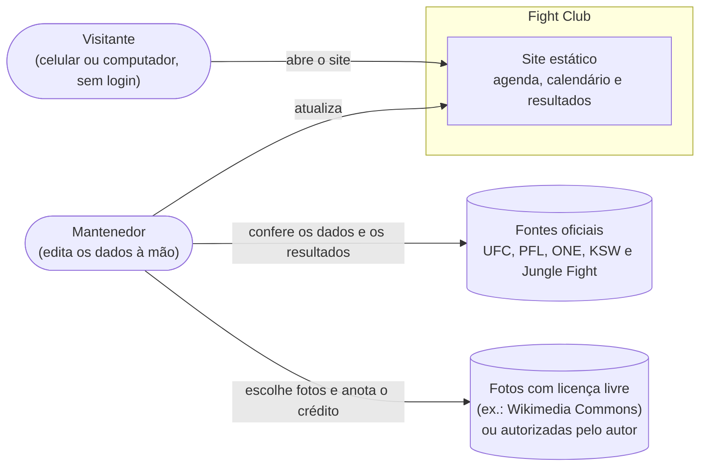
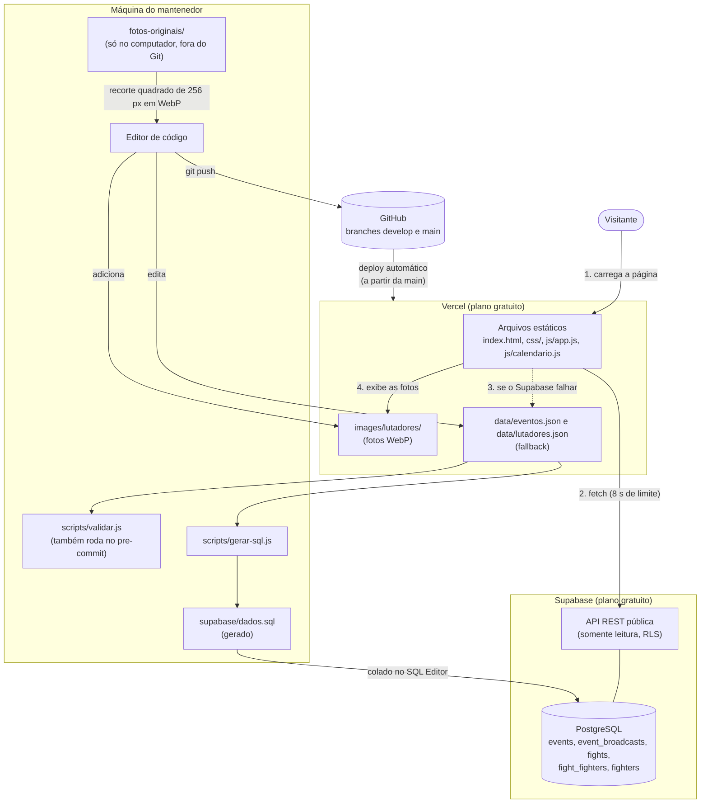
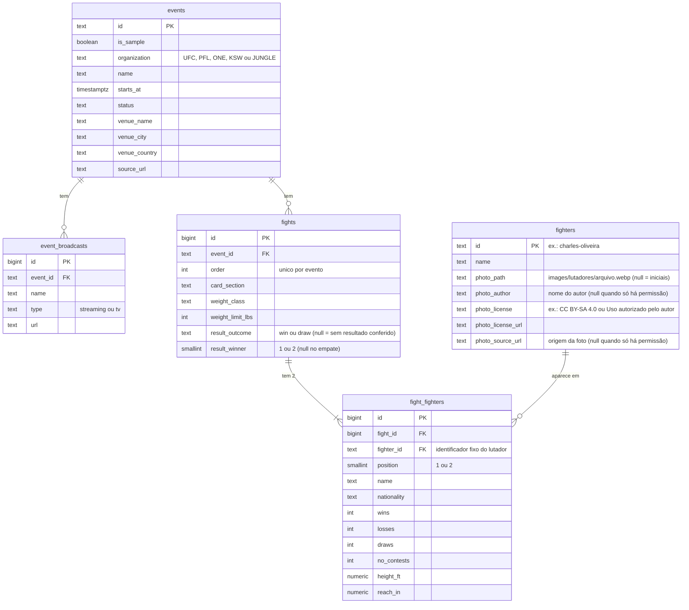

# Arquitetura do Fight Club

Os diagramas estão em Mermaid, e o GitHub os desenha direto na página. Este documento descreve a arquitetura do site e é atualizado sempre que uma mudança altera o esquema do banco ou o caminho dos dados.

## 1. Contexto: quem usa o site e de onde vêm os dados

- O site não tem login, não tem backend próprio e não cobra nada de ninguém.
- As fontes oficiais não são consultadas pelo site. Quem as confere é o mantenedor, e só depois os dados entram no projeto.
- Só entram fotos de lutadores com licença livre ou com permissão por escrito do dono dos direitos, sempre com crédito. A prova da permissão fica com o mantenedor, fora do repositório.

## 2. Contêineres: as peças do sistema

Como o site carrega os dados ([js/app.js](../js/app.js)):

1. Tenta o Supabase (`events` com `event_broadcasts` e `fights`, e cada luta com `fight_fighters` e `fighters`, numa só consulta). O limite é de 8 segundos.
2. Se o Supabase estiver pausado, demorar ou devolver zero eventos, usa `data/eventos.json` e `data/lutadores.json`. Por isso o JSON e o banco precisam ficar sempre iguais.
3. A data de "última atualização" vem do JSON, porque não está no banco.
4. As fotos vêm sempre da Vercel, nunca do Supabase. Por isso continuam aparecendo mesmo com o banco pausado, e não gastam o espaço do plano gratuito dele.

Como os dados chegam ao banco (fluxo manual, ver CLAUDE.md):

1. Editar `data/eventos.json` e, se houver lutador novo ou foto nova, `data/lutadores.json` e `images/lutadores/`. A foto original fica em `fotos-originais/` (fora do Git); só o recorte de 256 px em WebP, com o nome em minúsculas, vai para `images/lutadores/`.
2. Rodar `node scripts/validar.js` (o pre-commit também roda e bloqueia se houver erro).
3. Rodar `node scripts/gerar-sql.js`, que cria `supabase/dados.sql`.
4. Colar o `dados.sql` no SQL Editor do Supabase (ele apaga e reinsere tudo).
5. Commit com o JSON e o `dados.sql` juntos, e envio para o GitHub.

Segurança: a chave publicável do Supabase fica no código. A RLS só permite leitura para o acesso anônimo. A senha do banco e a chave service_role nunca entram no repositório.

## 3. Modelo de dados

Fonte: [supabase/schema.sql](../supabase/schema.sql).

Decisões de modelagem:

- **Resultado dentro de `fights`**: como cada luta tem no máximo um resultado, colunas na própria tabela evitam um JOIN a mais. `result_outcome` nulo significa "ainda sem resultado conferido" (o site mostra o selo "Não atualizado"). Só se guarda quem venceu ou se empatou: sem método, round nem tempo. Luta cancelada e luta sem resultado (no contest) ficam sem resultado.
- **Eventos sem card**: um evento com o card ainda não anunciado existe em `events` sem nenhuma linha em `fights`. O site mostra "Card a anunciar" e o validador aceita `fights` vazio. Nunca se inventam lutadores.
- **Cartel em `fight_fighters`**: `wins`, `losses` e os demais ficam na linha do lutador porque são o cartel **naquele evento**.
- **`fight_fighters` mantém `name`**: serve de reserva caso o lutador não tenha registro em `fighters`. `fighter_id` pode ser nulo para lutadores ainda sem cadastro.
- **Fotos no repositório**: `fighters` guarda só o caminho e o crédito. O arquivo fica em `images/lutadores/`, em WebP, quadrado, com cerca de 256 px e até 30 KB. Lutador sem foto conferida aparece com as iniciais. A foto vem de licença livre (ex.: Wikimedia Commons) ou, sem ela, de permissão por escrito do dono dos direitos; nesse caso a licença fica "Uso autorizado pelo autor" e `photo_license_url`, `photo_author` e `photo_source_url` podem ficar nulos. Por enquanto, só as lutas principais dos próximos eventos têm foto. O crédito aparece no `title` da foto, na lista da aba Sobre e, para licença livre, também no destaque do topo.
- **JSON espelha o banco**: `data/eventos.json` tem `result` nas lutas e `fighter_id` nos lutadores. `data/lutadores.json` tem os dados de `fighters`.
